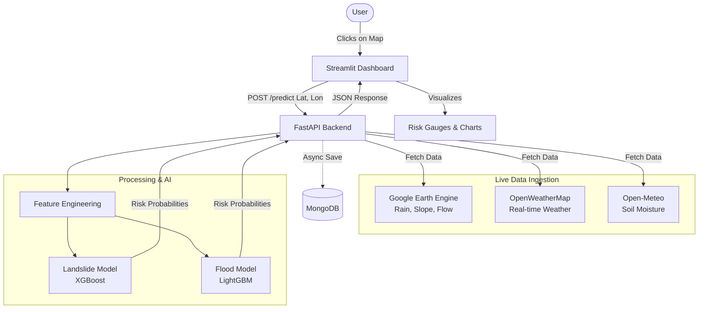

# 🌍 Real-Time Landslide & Flood Prediction System

**DeriveIT — AI-Powered Geospatial Disaster Risk Assessment**

   

## 📌 Project Overview

This system leverages **satellite data (NASA GPM, soil moisture)** and **machine learning models (XGBoost for landslide, LightGBM for flood)** to provide real-time landslide and flood risk assessments for any location in India. The interactive dashboard allows users to select locations on a map and instantly visualize disaster probabilities, environmental metrics, and historical trends.

## ✨ Key Features

### 🗺️ Interactive Analysis

- **Click-Based Selection**: Analyze risk for any specific location in India just by clicking on the map.
- **Real-Time Data**: Current weather integration (Temperature, Wind, Pressure, Humidity).
- **Environmental Metrics**: Detailed insights on Rainfall (24h/72h), Soil Saturation, Slope, Elevation, and River Proximity.

### ⚠️ Disaster Prediction

- **Dual Risk Assessment**: Simultanous prediction of both **Landslide** and **Flood** risks.
- **Risk Levels**: Categorized alerts (High/Medium/Low) based on probability thresholds.
- **Historical Analysis**: View trends of risk probabilities over time to understand changing conditions.

### 🛰️ Live Data Integration

- **Earth Engine Integration**: Live feeds for Rainfall Radar overlays and Terrain Slope visualization.
- **Background Refresh**: Periodic data updates via background scheduling.

## 🌟 WOW Factors

1. **Real-Time Satellite Intelligence**: Unlike static models, this system pulls **live** precipitation data (NASA GPM), soil moisture, and terrain topography (HydroSHEDS) to generate predictions based on *current* ground realities.
2. **Dual-Layer Risk Engine**: A unified AI architecture that simultaneously predicts **Landslide AND Flood risks**, understanding the complex correlation between heavy rain, soil saturation, and terrain slope.
3. **Hyper-Local Precision**: Zoom into any village or confirm remote areas in India; the system computes risk for that **exact coordinate** using geospatial distance transforms (not just regional averages).
4. **Interactive 4D Visualization**: A professional-grade dashboard combining **3D terrain maps**, live weather radar overlays, and historical time-series data to tell the complete story of an unfolding disaster.
5. **Production-Ready Architecture**: Built on a robust **FastAPI + Docker + MongoDB** stack with asynchronous task management, ensuring the system is scalable, fault-tolerant, and ready for real-world deployment.

## 🏗️ System Architecture



---

## 🛠️ Technology Stack

| Component            | Technology                        | Description                                                   |
| -------------------- | --------------------------------- | ------------------------------------------------------------- |
| **Backend**    | **FastAPI**                 | High-performance API for model inference and data processing. |
| **Hosting**    | **Uvicorn**                 | ASGI server for running the FastAPI application.              |
| **Database**   | **MongoDB (Motor)**         | Async database driver for storing historical data and logs.   |
| **ML Models**  | **XGBoost, LightGBM, Scikit-learn** | Predictive models for landslide and flood probability.        |
| **Geospatial** | **Google Earth Engine API** | Satellite imagery and environmental data retrieval.           |
| **Frontend**   | **Streamlit**               | Interactive web dashboard for visualization.                  |
| **Mapping**    | **Folium**                  | Leaflet-based maps for location selection and data overlay.   |
| **Charts**     | **Plotly**                  | Dynamic charts for visualizing historical trends.             |
| **DevOps**     | **Docker & Docker Compose** | Containerized deployment for consistent environments.         |

---

## 🚀 Installation & Setup

### Prerequisites

- **Docker & Docker Compose** (Recommended)
- **Google Earth Engine Service Account**: You need a `service-account.json` key file for Earth Engine access.

### Option 1: Run with Docker (Recommended)

1. **Clone the Repository**

   ```bash
   git clone https://github.com/yashasraj2324/landslide-and-flood-perdiction.git
   cd landslide-and-flood-perdiction
   ```
2. **Configure Credentials**

   - Place your Earth Engine `service-account.json` file inside the `backend/` directory.
   - Alternatively, set the `EARTH_ENGINE_SERVICE_ACCOUNT` and `EARTH_ENGINE_KEY_FILE` environment variables.
3. **Start the Application**

   ```bash
   docker-compose up --build
   ```
4. **Access the Application**

   - **Dashboard**: [http://localhost:8501](http://localhost:8501)
   - **API Documentation**: [http://localhost:8000/docs](http://localhost:8000/docs)

### Option 2: Manual Setup (Local Development)

If you prefer running without Docker, follow these steps:

#### Backend Setup

1. Navigate to the backend directory:
   ```bash
   cd backend
   ```
2. Install dependencies:
   ```bash
   pip install -r requirements.txt
   ```
3. Run the FastAPI server:
   ```bash
   python main.py
   ```

   *Server will start at http://localhost:8000*

#### Frontend Setup

1. Open a new terminal and navigate to the frontend directory:
   ```bash
   cd frontend
   ```
2. Install dependencies:
   ```bash
   pip install -r requirements.txt
   ```
3. Run the Streamlit dashboard:
   ```bash
   streamlit run dashboard.py
   ```

   *Dashboard will open at http://localhost:8501*

---

## 🧪 Models & Evaluation

Facts below come from the training notebooks (`notebooks/`) and `models/`. Metrics are the values printed in the notebook outputs, on a single random 80/20 split (`random_state=42`); nothing was re-run for this README.

| | Landslide | Flood |
|---|---|---|
| Model | `XGBClassifier` (300 trees, depth 6) | `LGBMClassifier` (600 trees, 64 leaves) |
| Features | `elevation`, `rainfall`, `soil_ph`, `slope` | `lat`, `lon`, `rain_24h`, `rain_72h`, `soil_saturation`, `elevation`, `slope`, `flow_accumulation`, `river_distance` |
| Rows | 31,545 (25,236 train / 6,309 test) | 33,373 (26,698 train / 6,675 validation) |
| Positives | 3,154 (10%) | 912 (2.7%) |
| Decision threshold | 0.5 (`models/threshold.pkl`) | 0.25 (notebook evaluation) |

**Flood** (validation set, threshold 0.25): ROC-AUC 0.984; flood class precision 0.65, recall 0.81, F1 0.72. The split is random, not spatial, and `lat`/`lon` are features, so neighbouring points can land on both sides of the split and these numbers are likely optimistic.

**Landslide** (test set, threshold 0.5): accuracy 0.70; landslide class precision 0.11, recall 0.29, F1 0.16. These labels are not real landslide events: the join against the GSI landslide inventory produced no positive labels, so the notebook assigns 10% of rows as landslides at random (`No positive landslide labels found from GSI data. Simulating 10% positive labels.`). Treat the landslide output as a placeholder, not a validated predictor.

---

## 📖 Usage Guide

1. **Open the Dashboard**: Navigate to `http://localhost:8501`.
2. **Select a Location**: Click anywhere on the map (default view centers on India).
3. **View Results**: The right sidebar will populate with:
   - **Risk Levels**: High/Medium/Low indicators for Landslide and Flood.
   - **Detailed Metrics**: Rainfall, Soil Saturation, Slope, Elevation, etc.
   - **Weather Info**: Current temperature, wind speed, and humidity.
4. **Analyze Trends**: Scroll down to see historical graphs for risk probability and environmental factors.
5. **Toggle Layers**: Use the sidebar options to show/hide Rainfall Radar overlays.

---

## 📂 Project Structure

```
landslide-and-flood-perdiction/
├── backend/                # FastAPI application
│   ├── app/                # Main application logic
│   │   ├── api/            # API endpoints
│   │   ├── core/           # Configuration
│   │   ├── db/             # Database connection logic
│   │   ├── models/         # Pydantic models
│   │   └── services/       # External services (EE, Weather)
│   ├── main.py             # Entry point
│   └── requirements.txt    # Python dependencies
├── frontend/               # Streamlit dashboard
│   ├── dashboard.py        # Main dashboard script
│   └── requirements.txt    # Python dependencies
├── models/                 # ML Models directory
├── notebooks/              # Jupyter notebooks for analysis
├── docker-compose.yml      # Docker orchestration
└── README.md               # Project documentation
```

## 🤝 Contributing

Contributions are welcome! Please open an issue or submit a pull request for any improvements or bug fixes.

## 📄 License

This project is licensed under the MIT License.
